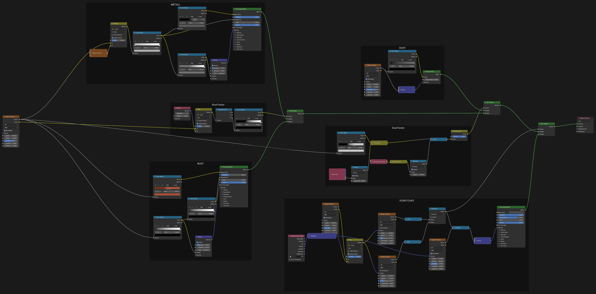
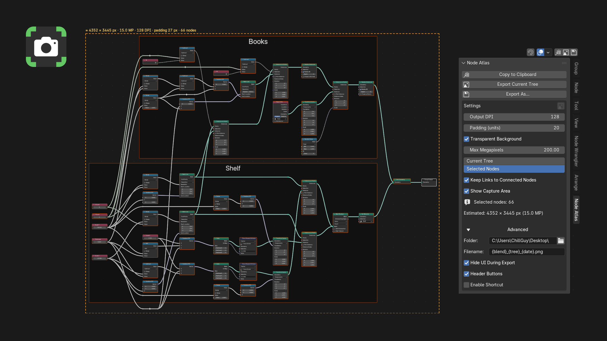

Exports any Blender node tree as one high-resolution PNG — Shader, Geometry Nodes,
Compositor or Texture, the whole graph, on the real editor background or on a transparent
one.

`Blender 4.2+` · `GPL-3.0-or-later` · `Windows tested`

## What it does

| Capability | Detail |
| --- | --- |
| **Whole graph** | Tiles the editor and stitches the tiles; nodes outside the view are included |
| **Density** | Output DPI sets the size (96 = 1:1, default 128); monitor DPI and zoom do not matter |
| **Padding** | Captured from the editor in units: 1 unit = 1 px at 96 DPI, so 20 units = 27 px at 128 DPI |
| **Transparent Background** | Removes the editor background and the padding; every tile is captured twice, so it takes about twice as long |
| **Preview** | Optional dashed rectangle and size label over the capture area; the export hides it |
| **Scope** | Current tree, or selected nodes through a temporary copy; links to connected nodes can stay |
| **Output** | PNG file or clipboard; `Esc` cancels |
| **Safety** | Max Megapixels 200 stops before capture; read-only folders and full disks are checked first |
| **Undo** | No undo step; editor, selection and view are restored after success, error or cancel |

> [!NOTE]
> During export the editor is maximized and the graph scrolls while tiles are captured; the
> interface scale may rise for dense output. Everything is restored afterwards.

## Use

Press `N` in a Node Editor → **Node Atlas** → **Export Current Tree**, **Export As…** or
**Copy to Clipboard**. Turn on **Show Capture Area** to see the exported rectangle with its
estimated size and padding; turn on **Transparent Background** to drop the background and
the padding.

## Install

| | |
| --- | --- |
| **Extension** | **Edit → Preferences → Extensions → Install from Disk…**, then pick `node_atlas-*.zip` from [Releases](https://github.com/kirillhod/NodeAtlas/releases) |
| **Classic** | Copy `node_atlas/` into `scripts/addons/` and enable it in **Add-ons** |

From source: `blender --command extension build --source-dir node_atlas`.

## Limits

- **GUI only.** Exports need a real window; `--background` cannot capture the editor.
- **One tree per export.** No batch export or SVG/JSON output.
- **Windows is the tested platform.** Validated on Blender 4.2.23, 4.5.9, 5.1.2, 5.2.4 and
  5.3.0; Linux, macOS and a second physical monitor are untested.
- **Selected Compositor nodes need Blender 5.1+.** Whole-tree compositor export works on
  4.2 and newer.
- **Copy to Clipboard may fail on very large images.** Save to a file instead.
- **The capture shows the editor as it is drawn.** A node row under the pointer keeps its
  hover highlight, so park the pointer outside the graph.
- **A transparent PNG keeps straight alpha.** Viewers show a checkerboard, and pasting it
  into another application may flatten it.

## Settings and defaults

| Setting | Default |
| --- | --- |
| Output DPI | `128` (96 = 1:1) |
| Padding | `20` units |
| Transparent Background | Off |
| Max Megapixels | `200` |
| Scope | Current Tree |
| Keep Links to Connected Nodes | Off (Selected Nodes scope only) |
| Show Capture Area | Off |
| Default Directory | Desktop (home if absent); `~` is expanded |
| Filename Pattern | `{blend}_{tree}_{date}.png`, plus `{datablock}` and `{type}` |
| Hide UI During Export, Header Buttons | On |
| Advanced | Off (folder, filename, UI and shortcut options hidden) |

## Troubleshooting

| Message | Fix |
| --- | --- |
| Output directory … is not writable | Choose a writable folder |
| Not enough free disk space | Free space on the destination drive |
| DPI clamped from X to Y | Lower Output DPI or raise Blender's UI scale |
| Output would be … above the N MP limit | Raise Max Megapixels or lower Output DPI |
| Node Editor is too small for export | Enlarge the Node Editor |
| `no image clipboard support` or `clipboard copy returned …` | Lower Output DPI or save to a file |
| No application could open … | Install a PNG viewer, or check that `xdg-open` exists on Linux |
| Could not measure the background step | Retry the export; report it if it repeats |

## Development

The add-on is plain Python with no third-party packages, and `node_atlas/` works both as
an extension and as a classic add-on. For a live loop, link or junction `node_atlas/` into
`scripts/addons/` and reload with **F3 → Reload Scripts**.

- Tests, tiers, the hang-safe runner, selecting affected tests:
  [`tests/README.md`](tests/README.md)
- Measured geometry, capture and stitching facts, one section at a time:
  [`NodeGraph_Export_Report.md`](NodeGraph_Export_Report.md), for example
  `python tools/doc.py NodeGraph_Export_Report.md 4.6`
- Verification on a real window: [`docs/agent/live-check.md`](docs/agent/live-check.md)
- Release and tagging procedure: [`docs/agent/release.md`](docs/agent/release.md)
- Scope and next work: [`ROADMAP.md`](ROADMAP.md)
- Repository rules and agent workflow: [`AGENTS.md`](AGENTS.md)

---

[Changelog](CHANGELOG.md) ·
[GPL-3.0](https://www.gnu.org/licenses/gpl-3.0.html) ·
[Issues](https://github.com/kirillhod/NodeAtlas/issues)
