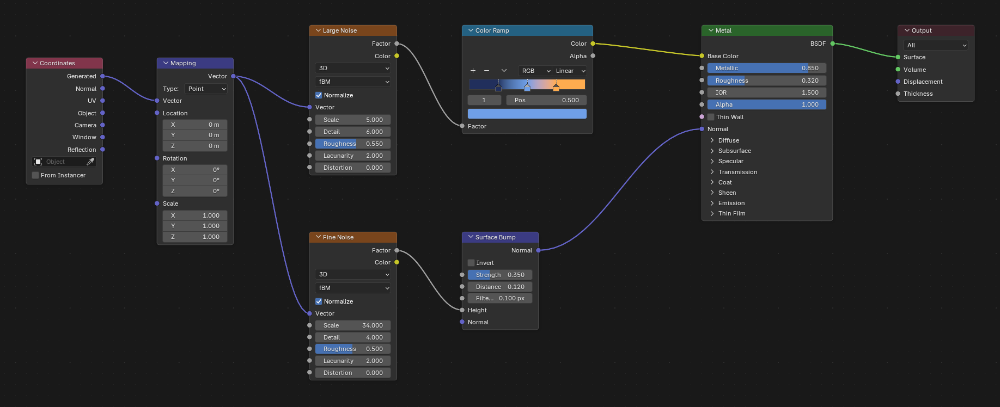
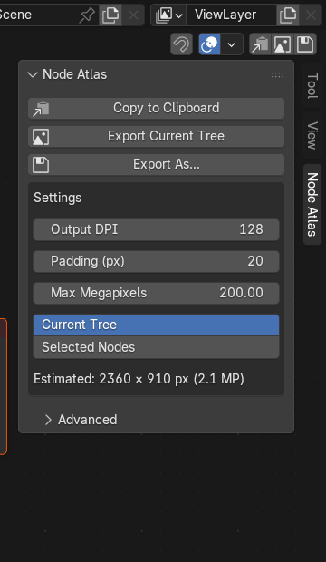

# Node Atlas

**[Blender](https://www.blender.org/) add-on that turns any node graph into one clean,
high-resolution PNG.**



## What it does

- **The whole graph in one image.** Nodes outside the visible area are captured and
  stitched automatically.
- **Crisp at any size.** Choose an output DPI; the result does not depend on your monitor
  or current zoom.
- **Only what you need.** Export the current tree or just the selected nodes.
- **Works across Blender.** Shader, Geometry Nodes, Compositor and Texture trees.
- **Clean presentation.** UI panels, gizmos and selection are hidden; the background is
  the real editor background, not a painted rectangle.
- **Your file stays untouched.** The editor, tree, selection and view are restored after
  success, error or cancel. No undo steps are added.
- **Copy to Clipboard.** Export straight to the clipboard without saving a file.

## Install

### Blender 4.2 or newer (extension)

1. Download the latest `node_atlas-*.zip` from the repository's **Releases** page.
2. In Blender open **Edit → Preferences → Extensions**.
3. Use **Install from Disk…**, choose the zip and enable **Node Atlas**.

If you work from source, build the zip with
`blender --command extension build --source-dir node_atlas` and install that.

### Classic add-on

Copy the `node_atlas` folder into your Blender `scripts/addons/` directory and enable
**Node Atlas** in **Edit → Preferences → Add-ons**.

## Use

<p align="center"></p>

1. Open any Shader, Geometry Nodes, Compositor or Texture Node Editor.
2. Press `N` and open the **Node Atlas** tab.
3. Choose:
   - **Copy to Clipboard** — put the image on the clipboard without writing a file.
   - **Export Current Tree** — save into the folder set as **Default Directory** in
     **Advanced**.
   - **Export As…** — pick a file name and location.
4. Press `Esc` to cancel a running export.

If **Default Directory** is empty, **Export Current Tree** opens the file dialog instead
of writing to a temporary folder. It starts at your Desktop by default. The quick-export
shortcut is disabled by default; configure it in **Advanced**.

## Settings

Settings live in the sidebar and in **Edit → Preferences → Add-ons → Node Atlas**.

- **Output DPI — 128.** 96 is 1:1 with node pixels; 128 gives a 33% larger image.
  The result does not depend on your monitor or current zoom.
- **Padding — 20 px.** Background margin around the graph.
- **Max Megapixels — 200.** A safety limit, not a target: the export stops before
  capturing if the image would exceed it. 200 MP is about 16000 × 12500 px.
- **Scope — Current Tree.** Export the whole tree or only selected nodes.
- **Default Directory — Desktop.** Folder for quick exports. Clear it to ask for a path
  every time.
- **Filename Pattern — `{blend}_{tree}_{date}.png`.** `{tree}` uses the material, object,
  scene or texture that owns the tree; `{datablock}`, `{type}` and `{date}` are also
  available. Unknown fields fall back to the default; spaces become `_`.
- **Export behavior.** Hide UI during export, restore the editor afterwards, keep the
  view deterministic, and show the three quick buttons in the Node Editor header.
- **Shortcut — off by default.** Enable it in **Advanced** and choose the key plus
  Ctrl/Shift/Alt, so it cannot conflict with an existing shortcut.

## Supported versions

Validated on Windows with Blender **4.2.23 LTS, 4.5.9 LTS, 5.1.2, 5.2.4 LTS and 5.3.0**.
The Compositor requires Blender 5.2 or newer. Linux and macOS are untested.

## Good to know

- This is a GUI add-on; it cannot capture the interface with `--background`.
- Keep the Blender window visible and unobstructed while exporting.
- Compositor export on Blender 4.2–5.1 is blocked by a Blender crash and shows a clear
  error instead.
- The view is restored to the nearest pixel; very long links may fade.
- Transparent backgrounds and batch export are planned for later versions.

## Troubleshooting

- **"Output directory … is not writable"** — choose a writable folder.
- **"Not enough free disk space"** — free space on the destination drive.
- **"DPI clamped from X to Y"** — the requested DPI is too high for the current UI
  scale. Lower Output DPI or increase Blender's UI scale.
- **"Output would be … above the N MP limit"** — raise Max Megapixels or lower Output
  DPI.
- **"Node Editor is too small for export"** — enlarge the Node Editor area.
- **Clipboard copy failed** — the OS may reject very large images; try a lower Output DPI.

## Development

Tests and the full test matrix are described in [`tests/README.md`](tests/README.md) and
[`QA_REPORT.md`](QA_REPORT.md). The measured specification and design notes are in
[`NodeGraph_Export_Report.md`](NodeGraph_Export_Report.md), with the roadmap in
[`IMPLEMENTATION_PLAN.md`](IMPLEMENTATION_PLAN.md) and changes in
[`CHANGELOG.md`](CHANGELOG.md).

The README images can be regenerated with a normal GUI Blender session:

```powershell
blender --factory-startup --python docs/make_images.py
```

## License

[GPL-3.0](https://www.gnu.org/licenses/gpl-3.0.html). See [`LICENSE`](LICENSE).
