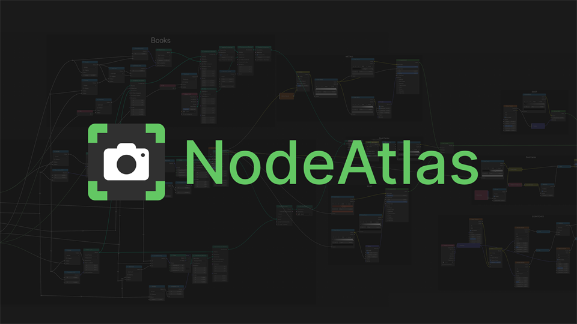
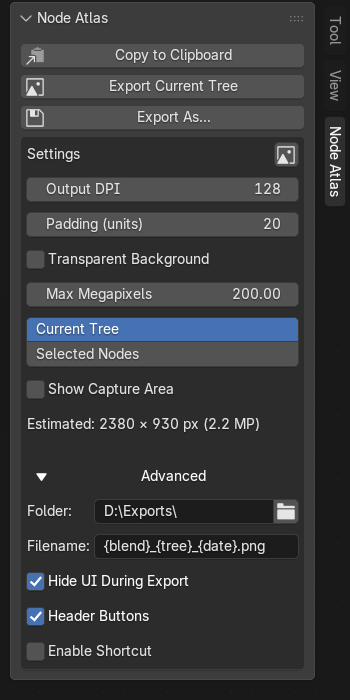

Exports any Blender node tree as one high-resolution PNG — Shader, Geometry Nodes,
Compositor or Texture, the whole graph, on the real editor background.

`Blender 4.2+` · `GPL-3.0-or-later` · `Windows tested`

## What it does

| Capability | Detail |
| --- | --- |
| **Whole graph** | Captures the editor in tiles and stitches them; nodes outside the view are included |
| **Density** | Output DPI sets the size (96 = 1:1, default 128); monitor DPI and zoom do not matter |
| **Padding** | Captured, not painted, in units: 1 unit = 1 px at 96 DPI, so 20 units = 27 px at 128 DPI |
| **Preview** | A dashed rectangle and its size label show exactly what will be captured; the export hides them automatically |
| **Scope** | Current tree, or selected nodes through a temporary copy that leaves your file intact; links to directly connected nodes can stay visible |
| **Output** | PNG file or clipboard; `Esc` cancels; the sidebar reopens the last export |
| **Safety** | Max Megapixels 200 stops before capture; DPI clamps are reported |
| **Undo** | Editor, selection and view restored after success, error or cancel |

> [!NOTE]
> During export the editor is maximized and the graph scrolls while tiles are captured; the
> interface scale may drop for dense output. Everything is restored afterwards.

## Use

Press `N` in a Node Editor → **Node Atlas** → **Export Current Tree**, **Export As…** or
**Copy to Clipboard**. The dashed frame over the graph is the exported rectangle, with its
estimated size and padding above it; uncheck **Show Capture Area** to hide the frame.

## Install

| | |
| --- | --- |
| **Extension** | **Edit → Preferences → Extensions → Install from Disk…**, then pick `node_atlas-*.zip` from [Releases](https://github.com/kirillhod/NodeAtlas/releases) |
| **Classic** | Copy `node_atlas/` into `scripts/addons/` and enable it in **Add-ons** |

From source: `blender --command extension build --source-dir node_atlas`.

## Limits

- **GUI only.** `--background` cannot capture the editor.
- **No transparent background** and **no batch export**.
- **Linux and macOS untested.** Windows: 4.2.23, 4.5.9, 5.1.2, 5.2.4, 5.3.0.
- **Selected Compositor nodes need Blender 5.1+.**
- **View returns to the nearest pixel;** the clipboard may refuse very large images.

## Settings and defaults

| Setting | Default |
| --- | --- |
| Output DPI | `128` (96 = 1:1) |
| Padding | `20` units |
| Max Megapixels | `200` |
| Scope | Current Tree |
| Keep Links to Connected Nodes | Off (Selected Nodes scope only) |
| Show Capture Area | On |
| Default Directory | Desktop |
| Filename Pattern | `{blend}_{tree}_{date}.png`, plus `{datablock}` and `{type}` |
| Hide UI, Restore UI, Deterministic View | On |
| Advanced, quick export shortcut | Off |

## Troubleshooting

| Message | Fix |
| --- | --- |
| Output directory … is not writable | Choose a writable folder |
| Not enough free disk space | Free space on the destination drive |
| DPI clamped from X to Y | Lower Output DPI or raise Blender's UI scale |
| Output would be … above the N MP limit | Raise Max Megapixels or lower Output DPI |
| Node Editor is too small for export | Enlarge the Node Editor |
| Clipboard copy failed | Lower Output DPI or save to a file |

---

[Changelog](CHANGELOG.md) ·
[GPL-3.0](https://www.gnu.org/licenses/gpl-3.0.html) ·
[Issues](https://github.com/kirillhod/NodeAtlas/issues)
